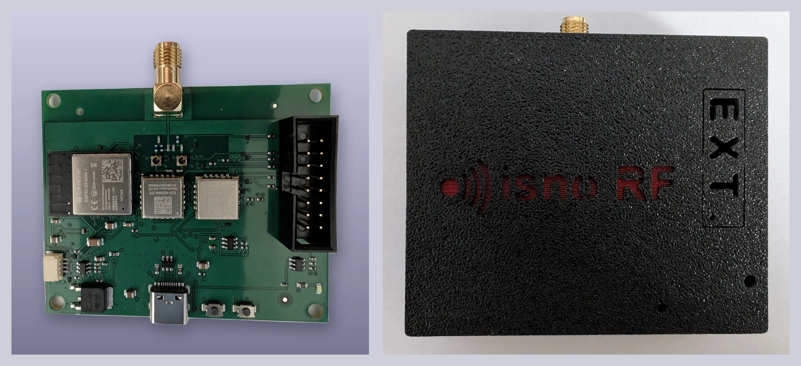
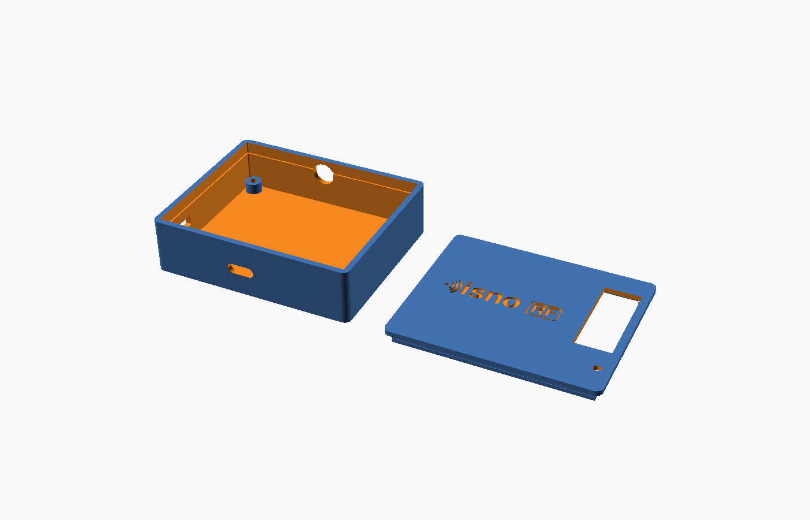
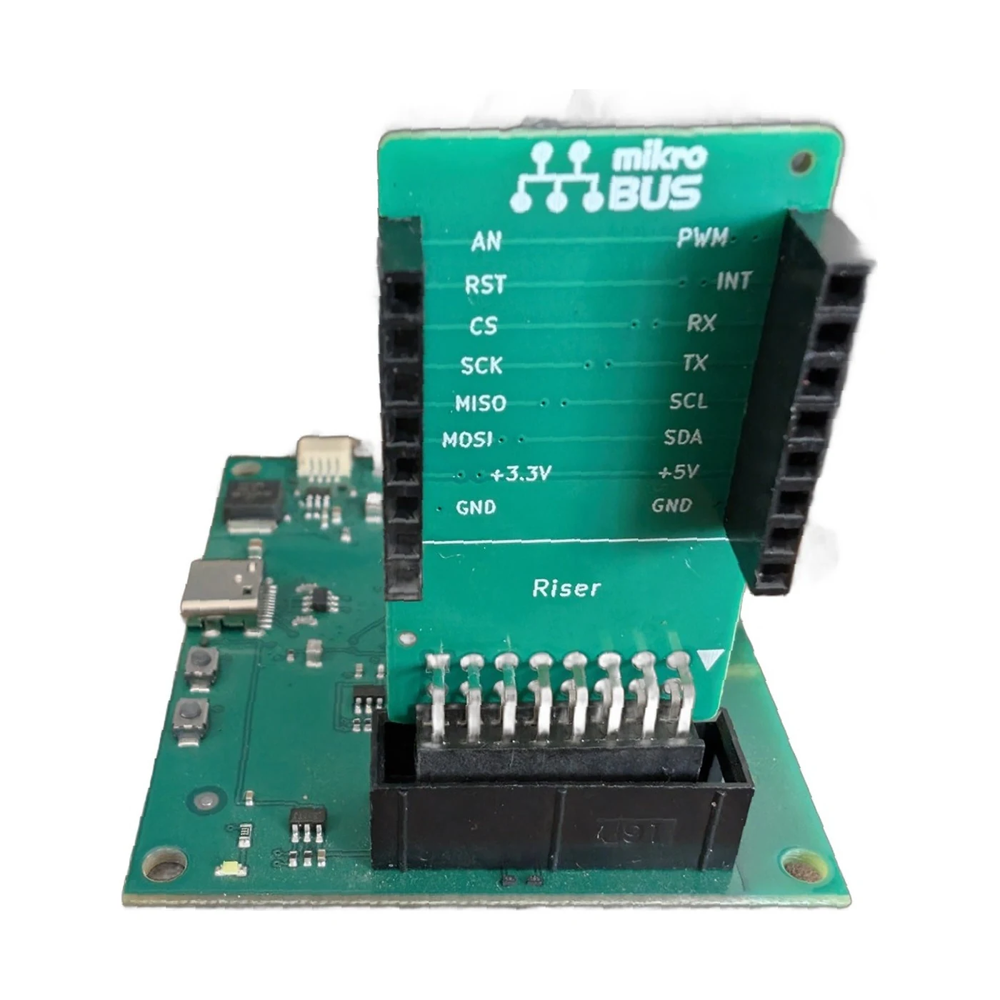
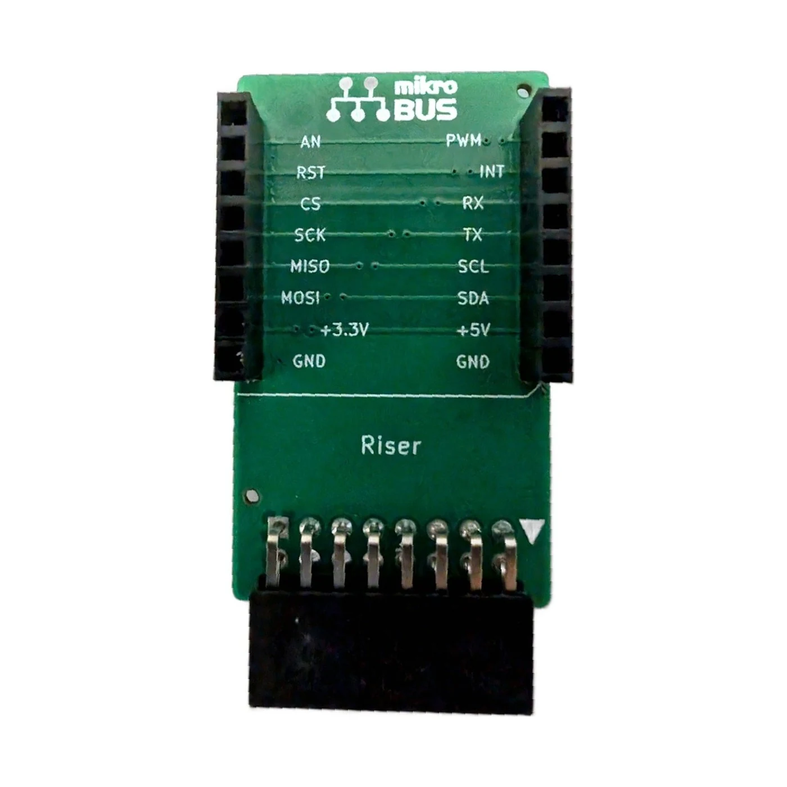

# OpenSuperRF : la carte radio ISNO Super, ouverte

*(English version : [README.md](README.md))*

**OpenSuperRF**, c'est le design ouvert de la carte **ISNO Super** : une carte radio sous-GHz à base
d'ESP32-S3, pensée pour faire tourner proprement des firmwares radio ouverts comme
[OpenProfalux](https://github.com/Isno-Open/OpenProfalux) (volets Profalux 868 MHz dans Home Assistant,
sans passerelle).

C'est la **v1.0 (EVT)**, la version qui a été fabriquée, montée et mesurée. Elle est publiée ici en open
hardware. La carte vendue en précommande est la **v1.1**, une évolution (voir
[v1.0 ouverte, v1.1 vendue](#v10-ouverte-v11-vendue)).

## Ce que c'est

- **ESP32-S3** en USB-C, alimenté par un LDO 3,3 V.
- **Deux radios CC1101**, **433 MHz et 868 MHz**, pilotées en SPI.
- Sur la v1.0, les deux radios sont combinées sur une **seule embase SMA** par un **diplexeur LC**.
- **Qwiic** (I2C) et **mikroBUS** (2x8) pour l'extension.
- Boutons **BOOT** et **RESET**, LED d'état.
- 4 couches, 67 x 55 mm. Marquage carte : `ISNO Super IoT HW REV 1.0`.

## Firmwares

La Super n'est pas liée à un firmware : c'est une carte **pour firmwares radio**. Elle fait notamment
tourner :

- **[OpenProfalux](https://github.com/Isno-Open/OpenProfalux)** : volets Profalux 868 MHz dans Home
  Assistant, sans passerelle.
- **[OpenRFTest](https://github.com/Isno-Open/OpenRFTest)** : firmware de test radio (émission/réception).

## Mesures RF (v1.0, au tinySA)

La v1.0 a été mesurée : porteuses uniques et propres, plancher de bruit bas, aucune raie parasite sur la
fenêtre observée.

## Schéma et brochage

mikroBUS (colonne gauche) : AN 8, RST 40, CS 34, SCK 36, MISO 37, MOSI 35, 3,3 V, GND.
mikroBUS (colonne droite) : PWM 38, INT 39, RX 18, TX 17, SCL 13, SDA 12, 5 V, GND.
Qwiic : GND, 3,3 V, SDA 12, SCL 13.

Le schéma complet est dans [`docs/isno-super-v1.0-schematic.pdf`](docs/isno-super-v1.0-schematic.pdf).

## Boîtier

Un boîtier imprimable en 3D est fourni dans [`enclosures/`](enclosures/) (`boitier_super.stl`). La carte
rentre aussi dans des boîtiers rail DIN et IP65.

## Accessoires

Ouverts ici aussi (produits, non modifiés depuis). Sources KiCad dans [`hardware/accessories/`](hardware/accessories/).

- **Riser mikroBUS** : surélève et déporte le connecteur mikroBUS.
- **Adaptateur mikroBUS**.

## v1.0 ouverte, v1.1 vendue

Pour être clair, et honnête :

- **v1.0** (ici, ouverte) : les deux radios combinées sur une **seule SMA** via un **diplexeur LC**. C'est
  la version testée et mesurée, publiée en open hardware pour l'étudier, la fabriquer, la modifier.
- **v1.1** (vendue en [précommande](https://www.isno.fr/boutique/isno-super)) : même chaîne radio
  (ESP32-S3 + double CC1101), mais le diplexeur est retiré au profit de **deux connecteurs d'antenne
  dédiés** (un par bande). C'est l'évolution affinée, prête à l'emploi et supportée.

Le DIY reste donc entièrement possible et libre ; la v1.1 est l'option « prête et fiable » pour qui ne
veut pas fabriquer.

## Contenu du dépôt

- `hardware/super/` : sources KiCad de la Super **v1.0** (schéma + PCB).
- `hardware/accessories/` : sources KiCad des accessoires (Riser mikroBUS, adaptateur).
- `hardware/OpenProfalux.pretty/`, `hardware/lib/` : empreintes et symboles nécessaires pour ouvrir le
  projet sous KiCad. La bibliothèque `.pretty` garde son nom historique (la carte a démarré sous le projet
  OpenProfalux) ; c'est juste la bibliothèque d'empreintes.
- `fab/` : les sorties de l'EVT fabriqué (Gerbers, BOM, CPL, rendu 3D, rapports EMC et thermique).
- `enclosures/` : boîtier imprimable en 3D.
- `docs/` : schéma PDF, BOM, notes de production.
- `images/` : photos, mesures RF, rendus.

## Licence

Matériel : **CERN-OHL-S v2** (voir [`LICENSE`](LICENSE)). Firmwares associés : voir leurs dépôts.

## Liens

- La carte prête à l'emploi (v1.1) : https://www.isno.fr/boutique/isno-super
- L'article projet (contexte, mesures, choix de conception) : https://www.isno.fr/projets/isno-super
- Firmware volets Profalux : https://github.com/Isno-Open/OpenProfalux
