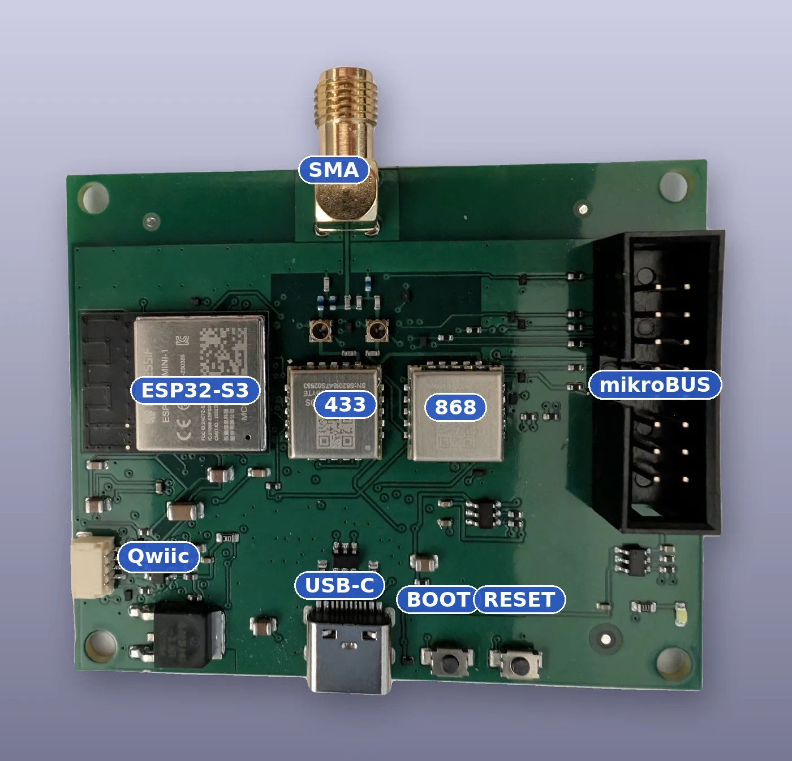
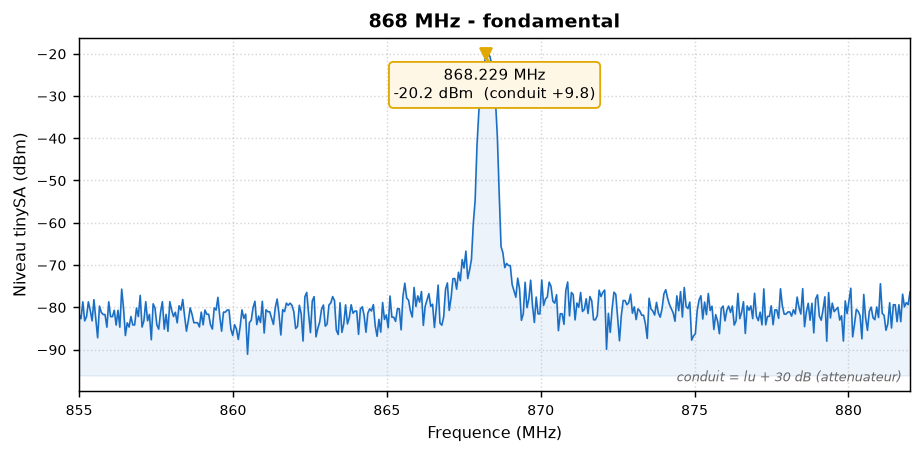
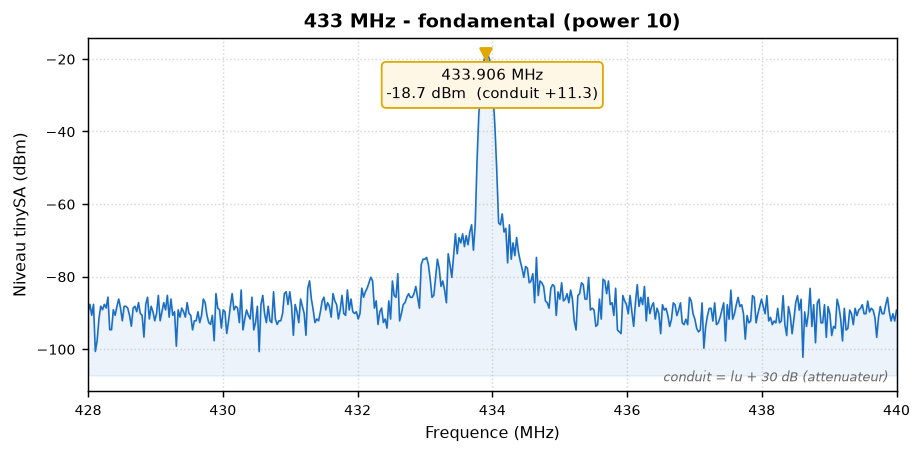
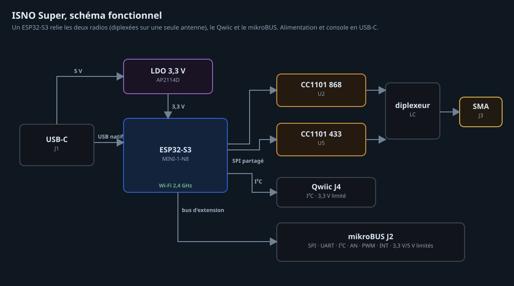
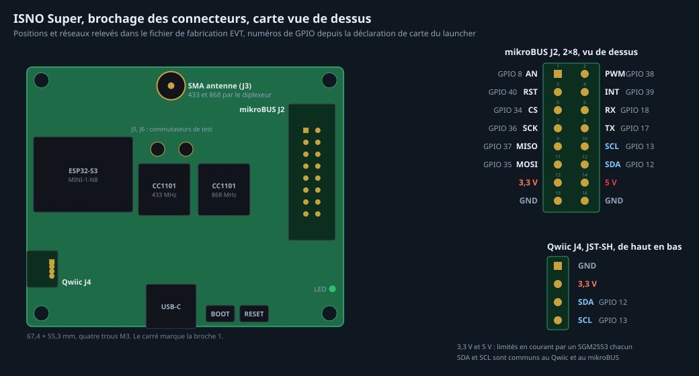
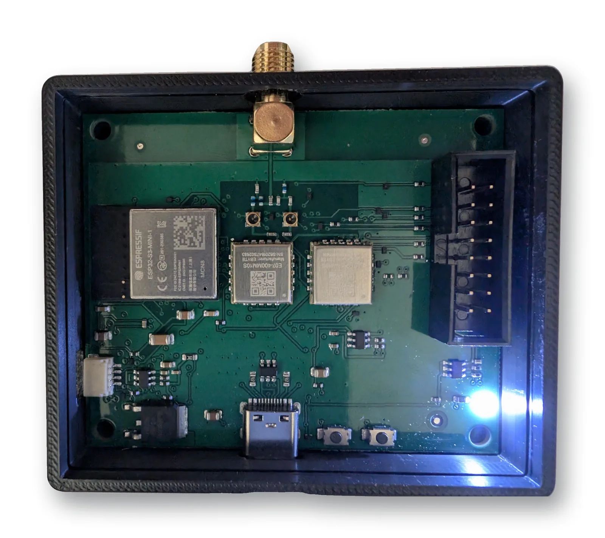

# OpenSuperRF — the ISNO Super radio board, open

*(Version française : [README.fr.md](README.fr.md))*

**OpenSuperRF** is the open design of the **ISNO Super**: a sub-GHz radio board built around
an ESP32-S3, made to cleanly run open radio firmwares such as
[OpenProfalux](https://github.com/Isno-Open/OpenProfalux) (Profalux 868 MHz shutters in Home
Assistant, no gateway).

This is the **v1.0 (EVT)**, the version that was **manufactured, assembled and measured**. It is
published here as open hardware. The board sold as a pre-order is the **v1.1**, a refinement
(see [v1.0 open / v1.1 sold](#v10-open--v11-sold)).

## What it is

- **ESP32-S3** over USB-C, powered by a 3.3 V LDO.
- **Two CC1101 radios**, **433 MHz and 868 MHz**, driven over SPI.
- On the v1.0, the two radios are **combined onto a single SMA** through an **LC diplexer**.
- **Qwiic** (I²C) and **mikroBUS** (2×8) for expansion.
- **BOOT** and **RESET** buttons, status LED.
- Board marking: `ISNO Super IoT HW REV 1.0`.

## Firmwares

The Super is not tied to one firmware, it is a board **for radio firmwares**. It notably runs:

- **[OpenProfalux](https://github.com/Isno-Open/OpenProfalux)** — Profalux 868 MHz shutters in
  Home Assistant, no gateway.
- **[OpenRFTest](https://github.com/Isno-Open/OpenRFTest)** — radio test firmware (TX/RX).

## RF measurements (v1.0, tinySA)

The v1.0 was measured: **single, clean carriers**, low noise floor, no spurious emissions over
the observed window.

## Schematic and pinout

mikroBUS (left column): AN 8, RST 40, CS 34, SCK 36, MISO 37, MOSI 35, 3.3 V, GND.
mikroBUS (right column): PWM 38, INT 39, RX 18, TX 17, SCL 13, SDA 12, 5 V, GND.
Qwiic: GND, 3.3 V, SDA 12, SCL 13.

The full schematic is in [`docs/isno-super-v1.0-schematic.pdf`](docs/isno-super-v1.0-schematic.pdf).

## In the enclosure

## Accessories

Also open here (produced, unchanged since):

- **mikroBUS riser** — raises and offsets the mikroBUS socket.
- **mikroBUS adapter**.

## v1.0 open / v1.1 sold

To be clear, and honest:

- **v1.0 (here, open)**: the two radios combined onto **a single SMA** through an **LC diplexer**.
  This is the tested and measured version, published as open hardware to study, build and modify.
- **v1.1 (sold as a pre-order)**: same radio chain (ESP32-S3 + dual CC1101), but the diplexer is
  **removed** in favour of **two dedicated antenna connectors** (one per band). It is the refined,
  ready-to-use and supported evolution.

DIY therefore stays fully possible and free; the v1.1 is the "ready and reliable" option for those
who would rather not build it.

## Repository contents

- `hardware/super/` — KiCad source of the Super **v1.0** (schematic + PCB).
- `hardware/accessories/` — KiCad source of the accessories (mikroBUS riser, adapter).
- `hardware/OpenProfalux.pretty/`, `hardware/lib/` — custom footprints and symbols to open the project.
- `fab/` — the manufactured EVT outputs: Gerbers, BOM, CPL, 3D render, EMC and thermal reports.
- `docs/` — schematic PDF, BOM, production notes.
- `images/` — photos, RF measurements, renders.

## Licence

Hardware: **CERN-OHL-S v2** (see [`LICENSE`](LICENSE)). Associated firmwares: see their own repos.

## Links

- Ready-to-use board (v1.1): https://www.isno.fr/boutique/isno-super
- Project article (context, measurements, design choices): https://www.isno.fr/projets/isno-super
- Profalux shutters firmware: https://github.com/Isno-Open/OpenProfalux
